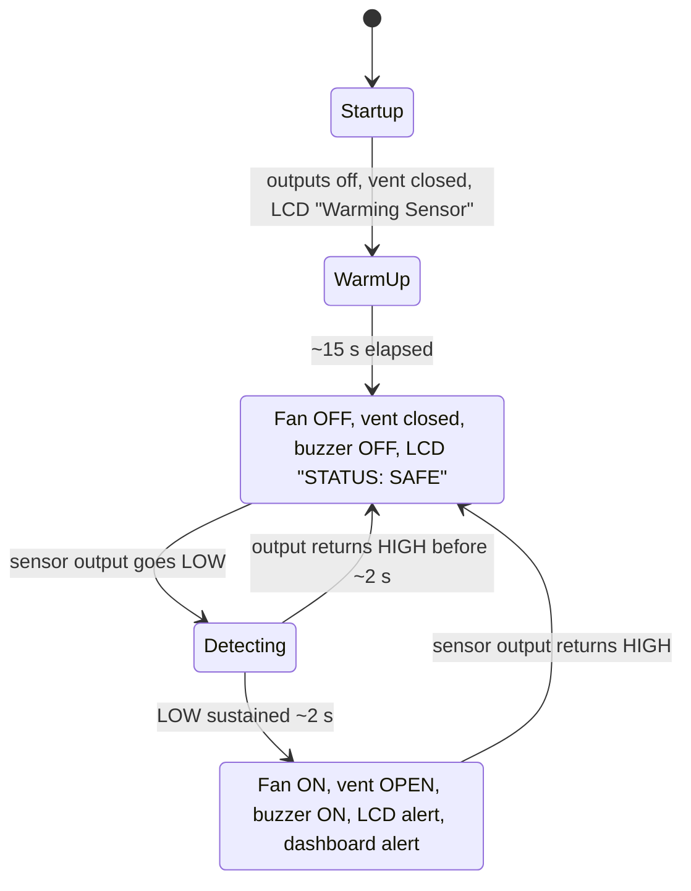

# How it works

## Stages

1. **Startup.** Relay off, servo to closed, buzzer disabled, LCD shows a warm-up message.
2. **Warm-up (~15 s).** No automation. This avoids startup false triggers but does not fully stabilize an MQ sensor (see known limitations).
3. **Safe monitoring.** Sensor output HIGH, everything off, LCD shows SAFE.
4. **Detection.** Sensor output goes LOW. The system checks it stays LOW for ~2 s before confirming.
5. **Automatic response.** Relay and fan on, vent open, buzzer on, LCD and dashboard updated.
6. **Reset.** When the sensor returns HIGH, outputs return to the safe state.

## Software notes

- **Previous-state tracking** detects SAFE <-> DETECTED transitions so outputs reset cleanly and manual controls are preserved.
- **LCD update function** only rewrites the display when content changes, which prevents flicker.
- **Relay** is driven HIGH for fan ON and LOW for fan OFF; it is held OFF during startup.
